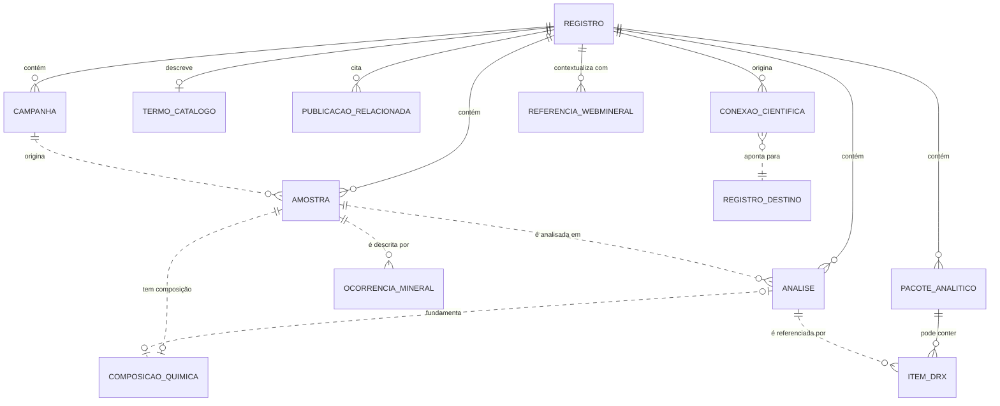

# Modelo de dados da Argiloteca

O registro InvenioRDM é a unidade de identificação, versionamento e publicação. Um registro pode descrever um artigo, um conjunto de dados com campanhas, amostras e análises, ou um termo do catálogo mineralógico. O perfil científico `1.0.0-hml.1` acrescenta blocos opcionais ao registro, com vínculos que permitem acompanhar a origem da amostra, o método de análise, o arquivo instrumental e a evidência que sustenta uma interpretação.

O modelo deriva das Figuras 4 e 5, dos capítulos 2 a 4 e 8 e dos apêndices A e C do *Manual integrado e guia de metadados* de 8 de novembro de 2026. O [dicionário de metadados](dicionario-metadados.json) cruza as 333 propriedades do capítulo 4 com os 16 JSON Schemas do projeto e inclui os 52 campos locais, com tipos, obrigatoriedade, condições, caminhos JSON e orientação de preenchimento.

## Entidades e relações



As linhas contínuas representam composição no registro e as tracejadas, referências por identificador. As cardinalidades descrevem o conteúdo de um registro versionado. `REGISTRO_DESTINO` é outro registro InvenioRDM. A referência do item DRX à análise representa a cadeia científica desejada. A validação genérica do pacote não garante que essa referência seja resolvida.

## Estrutura do registro

| Bloco | Caminho canônico | Cardinalidade no registro | Identificação ou mínimo no objeto |
| --- | --- | --- | --- |
| Registro | `metadata`, `access`, `files` e `custom_fields` | 1 envelope | PID e revisão administrados pelo InvenioRDM |
| Campanha | `custom_fields.arg:pesquisas_campo[]` | 0..N | `campanha_id` único no registro e `titulo` |
| Amostra | `custom_fields.arg:amostras[]` | 0..N | `codigo_amostra` único no registro e `campanha_id` local |
| Análise | `custom_fields.arg:analises[]` | 0..N | `analise_id` único no registro, `codigo_amostra` local e `metodo` |
| Ocorrência mineral | `custom_fields.arg:argilominerais[]` | 0..N | `codigo_amostra` local e presença de `nome` ou `nome_cientifico_padronizado` |
| Composição química global | `custom_fields.arg:composicao_quimica_global` | 0..1 | `codigo_amostra` local. `analise_id` é opcional e, quando preenchido, referencia uma análise local |
| Termo do catálogo | `custom_fields.arg:termo_catalogo` | 0..1 | `slug` estável, `nome_pt`, `nome_en`, `nome_cientifico_padronizado` e `situacao` |
| Publicação relacionada | `custom_fields.arg:publicacoes_relacionadas[]` | 0..N | `tipo`, `titulo`, `relacao_com_registro` e presença de `record_id`, `identificador_externo`, `doi` ou `url` |
| Conexão científica | `custom_fields.arg:conexoes_cientificas[]` | 0..50 pelo serviço | PID do destino em `record_id`, `papel`, `relacao` e `evidencia` |
| Pacote analítico | `custom_fields.arg:pacotes_analiticos[]` | 0..N | `pacote_id`, `record_id`, `analysis_type` e lista `items` |
| Item DRX | `custom_fields.arg:pacotes_analiticos[].items[]` | 0..N por pacote | `analise_id`, `codigo_amostra`, `arquivo_raw` e `raw_sha256` |
| Referência WebMineral | `custom_fields.arg:referencias_drx_webmineral[]` | 0..N | `id`, `argilomineral_id`, fonte e URL, papel auxiliar, tipo de referência, indicador de disponibilidade e `lines` |

O envelope de intercâmbio descreve um subconjunto do depósito nativo. Autoria, título, data de publicação, tipo de recurso, direitos, assuntos, identificadores e relações bibliográficas usam `metadata`. O acesso aos metadados e aos arquivos é controlado separadamente em `access.record` e `access.files`. Registros apenas de metadados podem usar `files.enabled: false`. Em um registro com perfil versionado, a presença de um bloco opcional aciona as regras dos seus objetos, mesmo quando outros blocos estão ausentes.

### Componentes reutilizados

| Componente | Uso | Regra formal de entrada |
| --- | --- | --- |
| Coordenada | Amostra, localidade ou depósito | `latitude` e `longitude` decimais entre −90 e 90, e −180 e 180, respectivamente. Datum, EPSG, precisão e procedência são opcionais. |
| Localidade | Amostra ou depósito | Presença de `nome` ou do par `latitude` e `longitude`. Pode conter uma coordenada detalhada. |
| Depósito mineral | Amostra | `deposito_id` e `nome`. Pode conter localidade, coordenada e contexto geológico. |
| Método analítico | Análise | `metodo_id` e `nome`. A análise mantém seu campo textual `metodo` obrigatório. |

## Identidade, proveniência e validação

**Vínculos locais.** Campanha, amostra e análise têm chaves lógicas compostas pelo PID do registro e pelo identificador local. O perfil rejeita chaves locais repetidas e referências locais inexistentes nos blocos de amostra, análise, ocorrência e química. O serviço confere separadamente os identificadores de amostra e análise na composição química. Conferir que a análise informada pertence à mesma amostra é uma revisão adicional. A ocorrência mineral referencia a amostra e mantém a fonte do nome e o contexto da descrição. O termo do catálogo possui identidade terminológica própria, com `slug` único e permanente no catálogo.

**Vínculos entre registros.** A publicação relacionada representa uma citação. Uma conexão científica registra origem, destino, papel, direção e evidência pública, com projeção em `metadata.related_identifiers` e navegação inversa calculada. Para conexões novas ou alteradas, o serviço verifica destino publicado e público, compatibilidade do papel e unicidade do destino na lista. O papel `termo` requer `slug` correspondente a um termo ativo e `relacao: references`. A origem e o destino devem ser distintos. `native_relation_created` é um controle interno.

**Arquivos e DRX.** Cada item DRX registra a amostra, a análise e a referência ao arquivo, com SHA-256 dos bytes. O vínculo operacional entre PID e `raw_id` tem estado, evidência, responsável e revisão. O processamento conserva formato, tamanho, preparo, eixos, unidades, radiação, parâmetros e versão quando disponíveis. A comparação N/G/C agrupa curvas dos preparos natural, glicolado e calcinado e registra as limitações de grupos incompletos. Curvas, relatórios e outros binários têm armazenamento e autorização próprios. O exportador pode classificar um item como DRX após validação contra seu schema. O pacote também aceita objetos genéricos, de modo que a aceitação do pacote sozinha deixa a estrutura DRX e suas referências sem verificação.

**Interpretação mineralógica.** `vinculo.state: confirmed` indica revisão da associação entre arquivo e registro. A identificação mineral depende de evidência e decisão científica próprias. Candidatos automáticos e linhas WebMineral documentam triagem. Para WebMineral o contrato fixa `usage: triagem_drx`, `validation_status: auxiliary_not_confirmatory` e `reference_kind: xray_powder_diffraction`. Dados externos conservam fonte, identificador, licença e versão ou snapshot quando disponíveis.

**Medidas e ausências.** Preservar a distinção entre campo ausente, `null`, vazio, zero e `false`. Registrar o referencial da coordenada e a unidade, o método e a base analítica da composição química. A unidade dos óxidos depende da fonte e o contrato não exige soma de 100%. Os requisitos de presença são formais. A revisão curatorial verifica, por exemplo, que o nome e o identificador de uma publicação são utilizáveis e que a procedência sustenta os valores informados.

**Escopo do perfil.** `arg:perfil_versao` identifica os registros submetidos às regras científicas versionadas. O rascunho pode preservar dados incompletos e devolver erros, enquanto a publicação aplica a validação estrita. Artigos bibliográficos podem ter apenas metadados nativos. Registros legados continuam com seu perfil anterior, com regras próprias para conexões e pacotes gerados pelo módulo DRX. Campos adicionais aceitos em objetos abertos têm exposição definida pelo exportador e pela autorização do registro.

## Persistência e intercâmbio

| Camada | Autoridade ou projeção |
| --- | --- |
| PostgreSQL | Os metadados canônicos são JSONB em `rdm_drafts_metadata.json` e `rdm_records_metadata.json`. Campanha, amostra e análise são objetos dentro de `custom_fields`. Vínculos e revisões operacionais de DRX possuem persistência própria. |
| Armazenamento de arquivos | Mantém binários e derivados autorizados. A disponibilidade pública depende do fluxo de publicação e das permissões do objeto. |
| OpenSearch | `arg:indice_cientifico_v1` é uma projeção reconstruível de amostras, análises, minerais, química e controles do perfil e do catálogo. |
| API e XML | A API usa JSON. O XML científico segue o XSD local e é oferecido pelo perfil `argiloteca` no OAI-PMH para registros elegíveis. `oai_dc` fornece a projeção bibliográfica. |
| Compatibilidade | Dos 46 campos históricos, cinco listas e um objeto de química também são blocos canônicos. Seis adições totalizam 52 definições locais. O dicionário identifica o papel de cada campo. |

Os atributos conceituais das Figuras 4 e 5 orientam a descrição. Profundidade, quantidade coletada e condições de armazenamento, por exemplo, não possuem chaves próprias nos schemas da amostra. Uma extensão desses atributos exigiria definir semântica, unidades, destino e regras de exposição.

## Exemplo sintético de registro

O exemplo demonstra a resolução de `campanha_id` e `codigo_amostra`, com base no apêndice C. A ocorrência abaixo ilustra o preenchimento em revisão. Os valores são didáticos.

```json
{
  "metadata": {
    "title": "Exemplo de descrição de uma amostra de argila",
    "publication_date": "2026",
    "resource_type": {"id": "dataset"},
    "creators": [
      {"person_or_org": {"type": "organizational", "name": "Equipe demonstrativa"}}
    ]
  },
  "access": {"record": "restricted", "files": "restricted"},
  "files": {"enabled": false},
  "custom_fields": {
    "arg:perfil_versao": "1.0.0-hml.1",
    "arg:pesquisas_campo": [
      {"campanha_id": "EX-CAMP-001", "titulo": "Exemplo didático de campanha"}
    ],
    "arg:amostras": [
      {"codigo_amostra": "EX-AM-001", "campanha_id": "EX-CAMP-001"}
    ],
    "arg:analises": [
      {"analise_id": "EX-AN-001", "codigo_amostra": "EX-AM-001", "metodo": "Difração de raios X"}
    ],
    "arg:argilominerais": [
      {
        "codigo_amostra": "EX-AM-001",
        "nome": "Caulinita",
        "nome_cientifico_padronizado": "Kaolinite",
        "observacao_proveniencia": "Atribuição didática sem evidência experimental."
      }
    ]
  }
}
```

## Referências do projeto

- [JSON Schemas do perfil científico](../../argiloteca_custom/argiloteca/scientific/schemas/)
- [Validação e projeção dos blocos científicos](../../argiloteca_custom/argiloteca/scientific/models.py)
- [Validação das conexões científicas](../../argiloteca_custom/argiloteca/scientific/connections.py)
- [Persistência e exportação de vínculos DRX](../../argiloteca_custom/argiloteca/scientific/drx_links.py)
- [Exportador científico XML](../../argiloteca_custom/argiloteca/scientific/xml.py)
